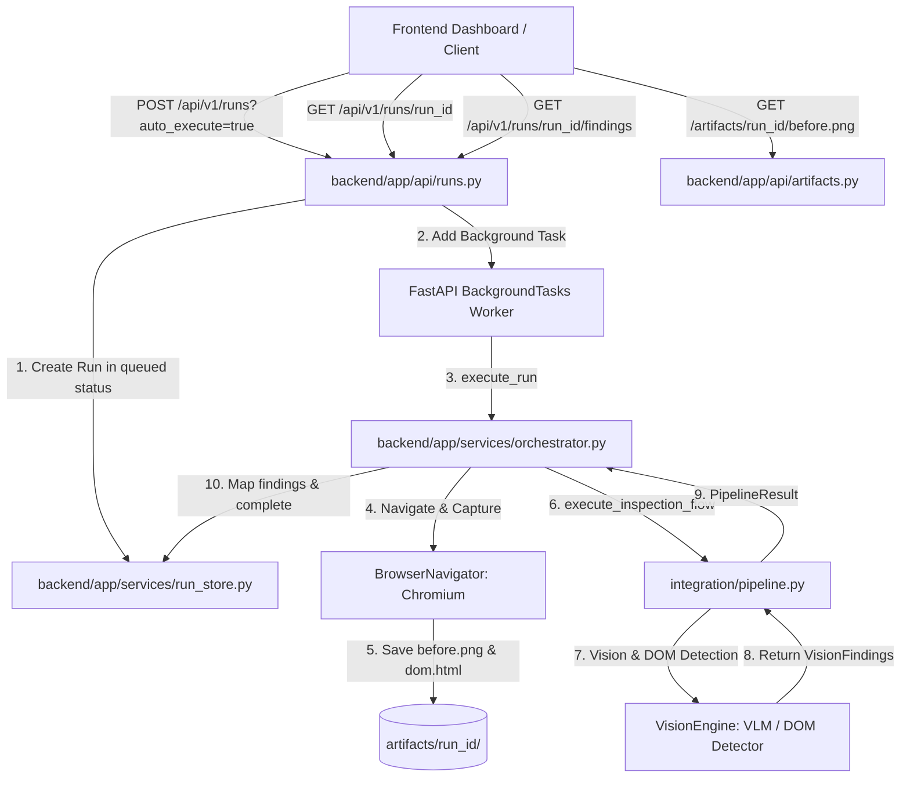

# OmniSight Backend Module Study Guide
**Module Lead:** Samiksha | **Component:** FastAPI Orchestration & REST API Backend

---

## 1. Executive Summary & Architectural Role

The **Backend Module** serves as the central orchestration brain of OmniSight. It exposes a typed REST API built with **FastAPI**, **Pydantic v2**, and **Uvicorn**. Its primary responsibilities include:

1. **Run Lifecycle Management:** Accepting inspection requests for web pages, generating unique `run_id`s, and advancing runs through states (`queued` -> `capturing` -> `analyzing` -> `completed` / `failed`).
2. **Subprocess & Agent Orchestration:** Coordinating the **Browser Agent** (headless Chromium navigation and evidence collection) and **Vision Engine** (defect detection and evidence validation).
3. **Self-Healing & GitHub Integration API:** Serving locator repair candidates, generating unified diff patches, and submitting pull requests.
4. **Artifact Serving:** Safely streaming screenshots and DOM snapshots to the frontend dashboard with path-traversal protection.
5. **State Storage:** Maintaining run metadata and finding records in memory via `RunStore`.



---

## 2. Directory Structure & File Map

```text
backend/
├── app/
│   ├── api/
│   │   ├── artifacts.py       # Static artifact streaming (screenshots, DOM snapshots)
│   │   ├── health.py          # Service health check endpoint
│   │   └── runs.py            # Inspection runs, findings, repair, and PR endpoints
│   ├── core/
│   │   └── logging.py         # Formatted logger configuration
│   ├── schemas/
│   │   ├── errors.py          # Standardized HTTP error response schema
│   │   ├── findings.py        # FindingResponse & EvidenceReferences schemas
│   │   ├── health.py          # HealthResponse schema
│   │   ├── repairs.py         # RepairResult, RepairProposal, PatchResult, PR schemas
│   │   └── runs.py            # RunCreateRequest & RunResponse (with secret masking)
│   ├── services/
│   │   ├── orchestrator.py    # RunOrchestrator: bridges pipeline, browser, and vision
│   │   └── run_store.py       # In-memory database singleton (RunStore)
│   └── main.py                # FastAPI app initialization, CORS, Windows loop policy
└── tests/
    ├── test_github_api.py     # Tests for PR submission and patch generation routes
    ├── test_health.py         # Tests for GET /health
    ├── test_integration.py    # Integration route tests
    ├── test_live_e2e_pipeline.py       # Live pipeline runs with local server
    ├── test_live_vlm_self_healing_e2e.py # End-to-end VLM and self-healing flows
    ├── test_orchestrator_pipeline.py   # Orchestrator lifecycle & Windows policy tests
    ├── test_repairs_api.py    # Tests for /repair, /proposals, and validation
    └── test_runs.py           # CRUD and validation tests for run routes
```

---

## 3. Core Components: Deep Dive

### 3.1 Application Entrypoint (`backend/app/main.py`)
- **FastAPI Instance (`app`):** Configured with title `"OmniSight Backend API"` and version `"0.1.0"`.
- **CORS Middleware:** Grants access to frontend origins (`localhost:5173`, `127.0.0.1:5173`, `localhost:3000`, `127.0.0.1:3000`).
- **Windows Event Loop Policy Guard:**
  ```python
  if sys.platform == "win32":
      if not isinstance(asyncio.get_event_loop_policy(), asyncio.WindowsProactorEventLoopPolicy):
          asyncio.set_event_loop_policy(asyncio.WindowsProactorEventLoopPolicy())
  ```
  *Why it is necessary:* On Windows, Uvicorn initializes using `WindowsSelectorEventLoopPolicy` in reload mode. However, Playwright's synchronous driver requires `WindowsProactorEventLoopPolicy` to spawn child subprocesses via I/O completion ports (IOCP). Setting this policy early ensures background worker threads spawn `ProactorEventLoop`s instead of crashing with `NotImplementedError`.

### 3.2 In-Memory Store (`backend/app/services/run_store.py`)
- **Class `RunStore`:**
  - `_runs: dict[str, RunResponse]`: Primary key is `run_id`.
  - `_findings: dict[str, list[FindingResponse]]`: Findings mapped to each run.
  - `_repairs: dict[str, list[Any]]`: Repair candidate results.
  - `_proposals: dict[str, list[Any]]`: Stored reviewable repair proposals.
- **Key Methods:**
  - `create(request: RunCreateRequest) -> RunResponse`: Generates `run_id = f"run_{uuid.uuid4().hex[:8]}"`, timestamp in UTC ISO-8601, and initial status `"queued"`.
  - `update_run(run_id, status=..., message=..., error=...)`: Updates run attributes safely using Pydantic's `model_dump()`.
  - `clear()`: Wipes in-memory dictionaries for test isolation between test cases.

### 3.3 Data Schemas (`backend/app/schemas/`)

#### `RunResponse` (`backend/app/schemas/runs.py`)
```python
class RunResponse(BaseModel):
    run_id: str
    url: str
    status: Literal["queued", "capturing", "analyzing", "repair_pending", "repairing", "verifying", "completed", "failed", "cancelled"]
    created_at: str
    message: str
    error: str | None = None
```
- **`model_validator(mode="after")`:**
  - Ensures that if `status == "failed"`, `error` and `message` can **never** be empty strings or `None`. If empty, it automatically defaults to `"Inspection run failed."`.
  - Automatically runs `mask_sensitive_strings(text)` using regular expressions to redact API keys (`api_key=...`, `token=...`) and Bearer headers (`Bearer ey...` -> `Bearer ***MASKED***`).

#### `FindingResponse` (`backend/app/schemas/findings.py`)
```python
class FindingResponse(BaseModel):
    finding_id: str
    category: Literal["layout_overflow", "missing_visible_element", "broken_image"]
    severity: Literal["low", "medium", "high", "critical"]
    confidence: float = Field(..., ge=0.0, le=1.0)
    description: str
    selector: str | None = None
    evidence: EvidenceReferences
    source: Literal["vlm", "mock"] = "mock"
```

### 3.4 Orchestration Service (`backend/app/services/orchestrator.py`)
- **`RunOrchestrator.execute_run(run_id: str, url: str)`:**
  1. Sets status to `"capturing"`: Launches Chromium through `BrowserNavigator` to navigate to the target URL, capture `artifacts/{run_id}/before.png`, and record `artifacts/{run_id}/dom.html`.
  2. Sets status to `"analyzing"`: Checks environment variables for VLM readiness (`GEMINI_API_KEY` or `OPENAI_API_KEY`). If available, wraps `detect_vlm()`; otherwise, defaults to `detect_dom_issues()`.
  3. Executes `execute_inspection_flow()` from `integration/pipeline.py`.
  4. Translates pipeline findings via `map_inspection_finding_to_response()`:
     - `overflow` -> `layout_overflow`
     - `missing_element` -> `missing_visible_element`
     - `broken_image` -> `broken_image`
     - Normalizes severities to `low`, `medium`, `high`, `critical`.
  5. Sets status to `"completed"` with finding count, or `"failed"` if any exception occurs.
  6. Top-level `try ... except` ensures tracebacks are logged with `logger.exception()` and never swallowed.

---

## 4. REST API Endpoints Reference

| Method | Endpoint | Description | Status Code |
| :--- | :--- | :--- | :--- |
| `GET` | `/health` | Backend service liveness probe | `200 OK` |
| `POST` | `/api/v1/runs` | Create a new inspection run (`auto_execute=true` enqueues background worker) | `201 Created` |
| `GET` | `/api/v1/runs` | List all stored inspection runs | `200 OK` |
| `GET` | `/api/v1/runs/{run_id}` | Retrieve run status, message, and error details | `200 OK` / `404` |
| `POST` | `/api/v1/runs/{run_id}/execute` | Explicitly trigger execution pipeline for a queued run | `200 OK` / `404` |
| `GET` | `/api/v1/runs/{run_id}/findings` | Retrieve list of structured findings for a completed run | `200 OK` / `404` |
| `POST` | `/api/v1/runs/{run_id}/repair` | Run self-healing locator repair against DOM evidence | `200 OK` / `400` / `404` |
| `POST` | `/api/v1/runs/{run_id}/proposals` | Create a reviewable repair proposal from a locator candidate | `201 Created` / `400` / `404` |
| `GET` | `/api/v1/runs/{run_id}/proposals` | List all generated repair proposals for a run | `200 OK` / `404` |
| `POST` | `/api/v1/runs/{run_id}/proposals/generate-patch` | Generate safe unified git diff for proposal | `200 OK` / `400` / `404` |
| `POST` | `/api/v1/runs/{run_id}/proposals/submit-pr` | Submit GitHub Pull Request (requires explicit approval flag) | `200 OK` / `400` / `404` |
| `GET` | `/api/v1/runs/config/github` | Check GitHub configuration status without leaking tokens | `200 OK` |
| `GET` | `/api/v1/runs/config/vlm` | Check VLM API key configuration status without leaking keys | `200 OK` |
| `GET` | `/artifacts/{run_id}/{filename}` | Stream before.png or dom.html from `artifacts/` | `200 OK` / `400` / `404` |

---

## 5. Security & Safety Controls

1. **Path Traversal Protection (`backend/app/api/artifacts.py`):**
   - Rejects file requests containing `..`, absolute paths, or characters outside alphanumeric filenames.
   - Enforces that resolved artifact files must reside strictly inside the `artifacts/{run_id}/` subdirectory.
2. **Credential Redaction:**
   - Error messages pass through regex filters before storage or response serialization, preventing raw API keys from surfacing in client UIs or logs.
   - `/runs/config/github` and `/runs/config/vlm` return boolean flags (`is_configured: bool`, `provider: str`), never raw secrets.
3. **User-Approval Gate for Pull Requests:**
   - `POST /submit-pr` explicitly rejects requests where `user_approved: false` with HTTP 400.

---

## 6. Testing Guide

Run all backend test suites using `pytest`:

```powershell
# Run all backend tests
pytest backend/tests

# Run specific orchestrator and route tests
pytest backend/tests/test_runs.py backend/tests/test_orchestrator_pipeline.py

# Run with verbose output and tracebacks
pytest backend/tests -v
```

---

## 7. Common Pitfalls & Troubleshooting

- **Symptom: Playwright fails with `NotImplementedError` during run execution on Windows.**
  - *Cause:* Event loop policy is set to `WindowsSelectorEventLoopPolicy`.
  - *Fix:* Ensure `backend/app/main.py` and `backend/app/services/orchestrator.py` enforce `WindowsProactorEventLoopPolicy`.
- **Symptom: Run stays in `"queued"` forever.**
  - *Cause:* Called `POST /api/v1/runs` without `?auto_execute=true` or without calling `/execute`.
  - *Fix:* Provide query parameter `auto_execute=true` or call `POST /api/v1/runs/{run_id}/execute`.
- **Symptom: Runs disappear after restarting Uvicorn.**
  - *Explanation:* By design for this milestone, `RunStore` is an in-memory dictionary. Persistence across server restarts requires a future database integration.

---

## 8. Likely Viva / Oral Examination Questions & Answers

**Q1: Why does OmniSight use FastAPI rather than Flask or Django?**
*Answer:* FastAPI provides automatic OpenAPI/Swagger documentation, native asynchronous request handling, built-in background tasks (`BackgroundTasks`), and typed request/response validation through Pydantic v2. This ensures high throughput and strict data contract enforcement between the frontend dashboard and internal engines.

**Q2: How does the backend execute long-running browser navigation without blocking HTTP requests?**
*Answer:* The run creation endpoint (`POST /api/v1/runs?auto_execute=true`) registers the run in `RunStore` as `"queued"`, returns HTTP 201 immediately with the `run_id`, and adds `RunOrchestrator.execute_run` as a background task. FastAPI offloads this synchronous function to a worker thread via `anyio.to_thread.run_sync`, allowing the main event loop to continue serving incoming API requests while the browser agent runs in the background.

**Q3: What happens if an exception occurs inside a background task?**
*Answer:* The entire execution body of `RunOrchestrator.execute_run()` is wrapped in a top-level `try ... except Exception as exc:` block. Any unexpected exception is logged with full traceback via `logger.exception()` and updates the run store with `status="failed"`, persisting a non-empty, actionable error message so the frontend can display the cause of failure.

**Q4: How does the backend prevent API secrets from leaking into error messages?**
*Answer:* The Pydantic model validator on `RunResponse` executes `mask_sensitive_strings()` on both `error` and `message` fields, replacing sensitive tokens (`api_key=...`, `token=...`, `Bearer ...`) with `***MASKED***` prior to JSON serialization.
