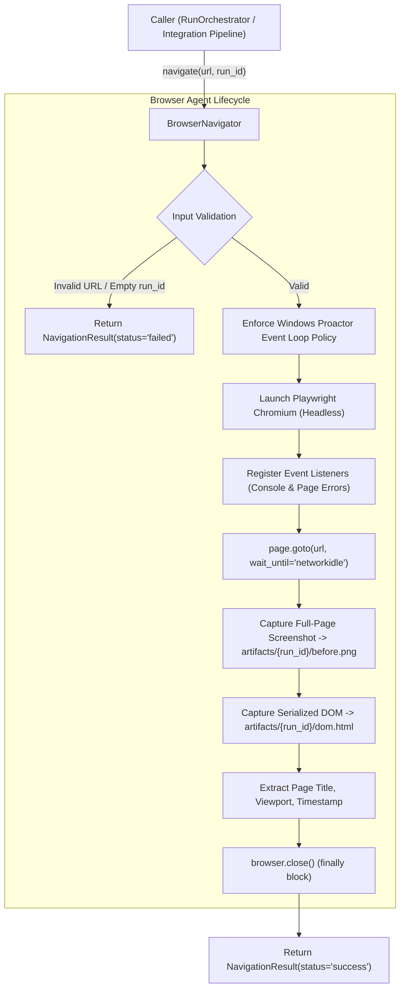

# OmniSight — Browser Agent Study Guide

> **Module Lead:** Janvi Kumari
> **Component:** `browser_agent/` (with compatibility aliases in `navigation/` and `screenshots/`)
> **Primary Technology:** Python 3.10+, Playwright (Chromium sync API), Asyncio Windows Event Loop Management

---

## 1. Module Overview & Architectural Role

The **Browser Agent** serves as the sensory gateway and autonomous navigation engine of OmniSight. Before any visual language model (VLM) can analyze a UI or any self-healing algorithm can suggest fixes, OmniSight must physically open the target web page, wait for scripts and dynamic resources to settle, and record physical evidence of the runtime state.



### Key Responsibilities:
1. **Headless Browser Orchestration:** Initializes a clean, isolated Chromium browser instance per run.
2. **Page Navigation & Stabilization:** Navigates to target HTTP/HTTPS URLs with configurable network timeouts and stabilization policies (`networkidle`).
3. **Runtime Error Interception:** Hooks into browser telemetry to capture `console.error` logs and unhandled JavaScript exceptions (`pageerror`).
4. **Evidence Collection:** Persists a full-page PNG screenshot and a serialized UTF-8 HTML DOM tree to the disk under `artifacts/{run_id}/`.
5. **Fail-Safe Resource Management:** Guarantees browser processes and pipes are terminated, even when navigation crashes or times out.

---

## 2. Directory & File Breakdown

```
browser_agent/
├── __init__.py                  # Module marker
├── evidence/
│   ├── __init__.py
│   └── dom_capture.py           # DOMCapture: saves page.content() to dom.html
├── navigation/
│   ├── __init__.py
│   └── navigator.py             # BrowserNavigator & NavigationResult dataclass
├── screenshots/
│   ├── __init__.py
│   └── screenshot_manager.py    # Compatibility wrapper pointing to root screenshots/
└── tests/
    └── __init__.py

Root Compatibility Aliases:
├── navigation/navigator.py      # Alias ensuring legacy imports function seamlessly
└── screenshots/screenshot_manager.py # ScreenshotManager implementation
```

---

## 3. Core Data Contracts: `NavigationResult`

Defined in [`browser_agent/navigation/navigator.py`](file:///c:/Users/praba/OneDrive/Documents/OmniSight%20-%20Multimodal%20UI%20Self-Healing%20&%20RPA%20Agent/browser_agent/navigation/navigator.py#L36-L52):

```python
@dataclass
class NavigationResult:
    run_id: str
    url: str
    page_title: str
    captured_at: str             # ISO-8601 UTC timestamp
    viewport: dict               # e.g., {"width": 1280, "height": 720}

    screenshot_path: Optional[str] = None   # "artifacts/{run_id}/before.png"
    dom_snapshot_path: Optional[str] = None # "artifacts/{run_id}/dom.html"

    console_errors: list = None  # List of console.error strings
    page_errors: list = None     # List of unhandled JS exception strings

    status: str = "success"      # "success" | "failed"
    error: Optional[str] = None  # Human-readable failure explanation
```

### Field Contracts & Semantics:
- **`status`**: Indicates whether navigation and evidence capture completed successfully. If any required stage fails (URL invalid, navigation timeout, file write error), status is `"failed"`.
- **`error`**: On failure, contains a descriptive message (e.g., `"Invalid URL"`, `"Navigation timeout"`, or specific exception text). It is never `None` if `status == "failed"`.
- **`console_errors`**: Filtered list containing exclusively browser console messages where `msg.type == "error"`. Warnings, debug logs, and standard info logs are ignored.
- **`page_errors`**: Contains unhandled exceptions occurring inside the browser window (e.g., `Uncaught TypeError: Cannot read properties of undefined`).

---

## 4. Line-by-Line Implementation Details

### A. Navigation Engine: `BrowserNavigator`

Located in [`browser_agent/navigation/navigator.py`](file:///c:/Users/praba/OneDrive/Documents/OmniSight%20-%20Multimodal%20UI%20Self-Healing%20&%20RPA%20Agent/browser_agent/navigation/navigator.py#L54-L186).

#### 1. Constructor Initialization:
```python
def __init__(self, timeout_ms: int = 30000, headless: bool = True):
    self.timeout_ms = timeout_ms
    self.headless = headless
```
- `timeout_ms`: Navigation limit (default 30,000 ms / 30 seconds).
- `headless`: Default `True`. In test or production environments, Chromium runs without an interactive desktop GUI.

#### 2. Pre-Navigation Validation:
```python
if not (url.startswith("http://") or url.startswith("https://")):
    return NavigationResult(..., status="failed", error="Invalid URL")

if not run_id:
    return NavigationResult(..., status="failed", error="run_id is required")
```
- Protects downstream subsystems from malformed input or file path injection before launching costly browser subprocesses.

#### 3. Windows Proactor Event Loop Policy Guard:
```python
if sys.platform == "win32":
    if not isinstance(asyncio.get_event_loop_policy(), asyncio.WindowsProactorEventLoopPolicy):
        asyncio.set_event_loop_policy(asyncio.WindowsProactorEventLoopPolicy())
```
- **Why this exists:** Playwright Python's `sync_api` communicates with the Chromium driver using asynchronous sub-processes over standard OS pipes. On Windows, the default `WindowsSelectorEventLoopPolicy` does not support asynchronous subprocesses, causing `NotImplementedError` when instantiated inside background threads or event-driven frameworks like Uvicorn. Setting `WindowsProactorEventLoopPolicy` resolves this issue.

#### 4. Event Listeners & Page Stabilization:
```python
with sync_playwright() as p:
    browser = p.chromium.launch(headless=self.headless)
    page = browser.new_page()

    # Capture console errors
    page.on("console", lambda msg: console_errors.append(msg.text) if msg.type == "error" else None)

    # Capture unhandled page JS exceptions
    page.on("pageerror", lambda exc: page_errors.append(str(exc)))

    # Navigate and wait for network traffic to halt
    page.goto(url, wait_until="networkidle", timeout=self.timeout_ms)
```
- `wait_until="networkidle"`: Ensures page navigation waits until there are no network connections for at least 500 ms. This allows dynamic web applications (such as React, Vue, or script-injected DOM nodes) to complete API queries and DOM mounting before evidence collection begins.

#### 5. Artifact Capture & Validation:
```python
screenshot_path = ScreenshotManager.save_screenshot(page, run_id)
if not Path(screenshot_path).exists():
    raise FileNotFoundError("Screenshot file not created")

dom_snapshot_path = DOMCapture.save_dom_snapshot(page, run_id)
if not Path(dom_snapshot_path).exists():
    raise FileNotFoundError("DOM snapshot file not created")
```
- After capturing the screenshot and DOM, the agent explicitly verifies their presence on the filesystem. If the operating system failed to write the file, an exception is raised immediately to prevent partial runs.

#### 6. Clean Resource Teardown:
```python
finally:
    try:
        if browser:
            browser.close()
    except Exception:
        pass
```
- Guarantees that whether navigation succeeds, times out, or throws an unhandled error, the headless Chromium process is closed and does not leak memory or zombie processes.

---

### B. Screenshot Capture: `ScreenshotManager`

Located in [`screenshots/screenshot_manager.py`](file:///c:/Users/praba/OneDrive/Documents/OmniSight%20-%20Multimodal%20UI%20Self-Healing%20&%20RPA%20Agent/screenshots/screenshot_manager.py#L13-L45):

```python
class ScreenshotManager:
    @staticmethod
    def create_run_directory(run_id: str, artifact_root: str = "artifacts") -> Path:
        run_dir = Path(artifact_root) / run_id
        run_dir.mkdir(parents=True, exist_ok=True)
        return run_dir

    @staticmethod
    def save_screenshot(page, run_id: str, artifact_root: str = "artifacts") -> str:
        run_dir = ScreenshotManager.create_run_directory(run_id, artifact_root)
        screenshot_path = run_dir / "before.png"
        page.screenshot(path=str(screenshot_path), full_page=True)
        return str(screenshot_path)
```
- **Full Page Capture (`full_page=True`)**: Scrolls through and stitches the entire document rendering context into one continuous image, ensuring overflow elements or below-the-fold defects are not clipped by viewport boundaries.

---

### C. DOM Capture: `DOMCapture`

Located in [`browser_agent/evidence/dom_capture.py`](file:///c:/Users/praba/OneDrive/Documents/OmniSight%20-%20Multimodal%20UI%20Self-Healing%20&%20RPA%20Agent/browser_agent/evidence/dom_capture.py#L4-L24):

```python
class DOMCapture:
    @staticmethod
    def save_dom_snapshot(page, run_id: str, artifact_root: str = "artifacts") -> str:
        run_dir = Path(artifact_root) / run_id
        run_dir.mkdir(parents=True, exist_ok=True)
        dom_path = run_dir / "dom.html"
        html_content = page.content()
        with open(dom_path, "w", encoding="utf-8") as file:
            file.write(html_content)
        return str(dom_path)
```
- `page.content()` extracts the **live, evaluated DOM tree** rather than static source code, capturing runtime DOM modifications executed by JavaScript.

---

## 5. Artifact Directory Layout

For each execution run `run_id`, the Browser Agent produces the following disk artifacts:

```
artifacts/
└── run_f06fd5fe/
    ├── before.png        # Full-page visual screenshot (PNG format)
    └── dom.html          # Evaluated live DOM structure (UTF-8 HTML)
```

These artifacts are consumed by:
1. **Vision Engine:** Reads `before.png` (encoded to base64) and inspects `dom.html` for heuristics.
2. **Self-Healing Engine:** Parses `dom.html` to find damaged selectors and generate repairs.
3. **Frontend UI:** Displays `before.png` in the Visual Evidence tab and renders `dom.html` in the DOM Evidence viewer.

---

## 6. Testing & Verification

Unit and integration tests for the browser agent are located in `tests/`:

| Test File | Focus Area |
| :--- | :--- |
| `tests/test_navigation.py` | Validates successful navigation against a local HTTP test server and tests malformed URL rejection. |
| `tests/test_screenshot.py` | Verifies that `before.png` is generated, non-empty, and succeeds even if images on the page fail to load. |
| `tests/test_dom_capture.py` | Ensures `dom.html` is persisted with full markup and matches expected DOM contents. |
| `tests/test_error_handling.py` | Tests navigation timeout handling, missing `run_id`, and console error list serialization. |

### Running the Tests:
```powershell
# Run all browser agent tests
pytest tests/test_navigation.py tests/test_screenshot.py tests/test_dom_capture.py tests/test_error_handling.py -v
```

> **Prerequisite:** Ensure Playwright browser binaries are installed:
> ```powershell
> playwright install chromium
> ```

---

## 7. Real vs. Mocked Behavior & Limitations

| Aspect | Current Implementation Status |
| :--- | :--- |
| **Browser Engine** | **Real**: Launches real headless Chromium via Playwright. |
| **Screenshot Capture** | **Real**: Captures full-page rasterized PNG rendering of live pages. |
| **DOM Tree Capture** | **Real**: Captures evaluated DOM via `page.content()`. |
| **Console & JS Error Hooks** | **Real**: Uses native Playwright event listeners (`page.on`). |
| **Multi-Tab / Multi-Window** | **Limitation**: Currently opens a single page per run. Secondary popups or OAuth windows are not tracked. |
| **Authentication / Cookies** | **Unimplemented**: Does not persist session state, browser cookies, or credentials across runs. |
| **Headless vs Headed** | **Configuration**: Default is headless. Can be set to `headless=False` for local visual debugging. |

---

## 8. Common Troubleshooting

1. **`NotImplementedError` on Windows during `p.chromium.launch()`:**
   - *Cause:* The active asyncio event loop is using `WindowsSelectorEventLoopPolicy`.
   - *Fix:* Ensure `asyncio.set_event_loop_policy(asyncio.WindowsProactorEventLoopPolicy())` runs prior to Playwright initialization (handled automatically in `BrowserNavigator.navigate`).
2. **`playwright._impl._errors.Error: Executable doesn't exist`:**
   - *Cause:* Chromium binary not downloaded.
   - *Fix:* Run `playwright install chromium` in your virtual environment.
3. **`Navigation timeout` on slow external sites:**
   - *Cause:* The page took longer than 30,000 ms to achieve `networkidle`.
   - *Fix:* Increase timeout via `BrowserNavigator(timeout_ms=60000)`.

---

## 9. Viva / Oral Exam Questions & Model Answers

### Q1: Why does OmniSight use `wait_until="networkidle"` instead of `"load"` or `"domcontentloaded"`?
> **Answer:**
> Standard `"load"` and `"domcontentloaded"` events trigger as soon as the initial HTML document and basic static assets parse. However, modern Single Page Applications (SPAs) like React or Angular render UI components dynamically via asynchronous client-side JavaScript. Using `networkidle` forces Playwright to wait until network traffic stops for at least 500 ms, ensuring that API responses have arrived, components have mounted, and the screenshot accurately reflects the rendered page state.

### Q2: How does the Browser Agent capture console errors without crashing or blocking page execution?
> **Answer:**
> Playwright provides non-blocking event emitters (`page.on("console", callback)` and `page.on("pageerror", callback)`). The Browser Agent attaches lightweight lambda listeners to these events before initiating navigation. When the browser engine encounters `console.error(...)` or an uncaught JavaScript runtime exception, the message text is appended to an in-memory list without interrupting the main browser thread or throwing a Python exception.

### Q3: Why does `sync_playwright()` fail on Windows when called from an asynchronous web framework like FastAPI/Uvicorn?
> **Answer:**
> Playwright's synchronous API runs an internal event loop to communicate with the Chromium subprocess over OS pipes. On Windows, Python's default event loop policy in some environments is `WindowsSelectorEventLoopPolicy`, which does not support asynchronous subprocess communication. When Uvicorn runs with reload mode or inside background threads, this mismatch triggers a `NotImplementedError`. Enforcing `WindowsProactorEventLoopPolicy` provides the required I/O completion ports (IOCP) support for subprocesses on Windows.

### Q4: If an image on the target webpage fails to load (HTTP 404), does `BrowserNavigator.navigate()` fail?
> **Answer:**
> No. A 404 response for a sub-resource like an image or CSS file does not cause `page.goto()` to throw an exception; it only records an entry in the browser console or network log. As long as the primary page returns a valid document and network activity ceases, navigation succeeds, and the visual defect (e.g., broken image icon) is captured in `before.png` for Jay's Vision Engine to detect.
