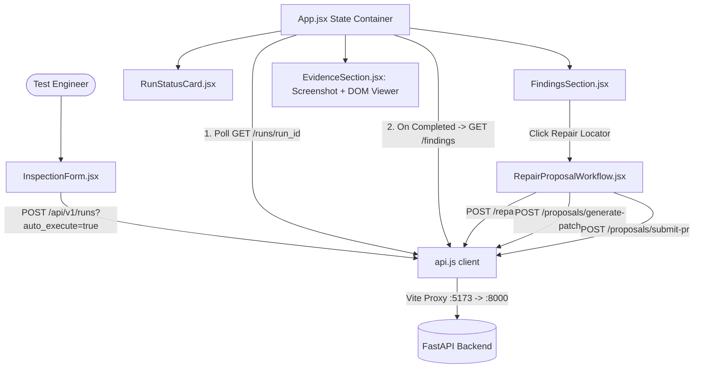

# OmniSight Frontend Module Study Guide
**Module Lead:** Samiksha | **Component:** React 18 / Vite Self-Healing RPA Dashboard

---

## 1. Executive Summary & Architectural Role

The **Frontend Module** is the interactive web dashboard for OmniSight. Built using **React 18**, **Vite**, and modular **Vanilla CSS**, it provides test engineers and automation leads with a unified cockpit to:

1. **Trigger Multimodal Inspections:** Enter target URLs or select pre-configured demo site scenarios (`Clean`, `Overflow`, `Missing Element`, `Broken Image`, `All Defects`).
2. **Track Live Execution Telemetry:** Poll backend runs through stages (`queued` -> `capturing` -> `analyzing` -> `completed` / `failed`) with real-time status indicators.
3. **Inspect Multimodal Defect Findings:** View categorized findings (`layout_overflow`, `missing_visible_element`, `broken_image`), severity badges, confidence ratings, and DOM selectors.
4. **Examine Synchronized Evidence:** Inspect side-by-side screenshots (`before.png`), raw DOM snapshots (`dom.html`), and browser console error logs.
5. **Review & Approve Self-Healing Repairs:** Execute automated locator repairs, preview generated unified Git diffs, and submit GitHub Pull Requests under explicit human approval.



---

## 2. Directory Structure & File Map

```text
frontend/
├── package.json               # Node scripts (dev, build, preview, test) & dependencies
├── vite.config.js             # Vite configuration with /api and /artifacts proxy
├── index.html                 # Single-page HTML shell mounting React root
├── src/
│   ├── main.jsx              # React DOM entrypoint rendering <App />
│   ├── App.jsx               # Central state container, polling timers, and layout
│   ├── App.css               # Design system: themes, glassmorphism, responsive grid
│   ├── components/
│   │   ├── Header.jsx         # Navigation bar, brand logo, and backend health status
│   │   ├── InspectionForm.jsx # Target URL input, demo scenario buttons, auto-execute toggle
│   │   ├── RunStatusCard.jsx  # Active run lifecycle badge, timing, and error alerts
│   │   ├── FindingsSection.jsx# Categorized finding list, severity tags, repair trigger
│   │   ├── EvidenceSection.jsx# Split visual viewer: Screenshot image & DOM code viewer
│   │   ├── RepairProposalWorkflow.jsx # 4-step repair, patch preview, and PR submission
│   │   └── Alert.jsx          # Dismissible banner for success/error feedback
│   └── services/
│       ├── api.js             # Centralized asynchronous HTTP fetch client
│       └── api.test.js        # Node.js native unit tests for URL parsing & API contracts
```

---

## 3. Core Component Breakdown

### 3.1 Main Container (`frontend/src/App.jsx`)
`App.jsx` serves as the single source of truth for the dashboard's operational state.

#### Core State Variables:
- `health`: Backend health status object (`{ status: "ok", service: "omnisight-backend" }`).
- `currentRun`: Currently active inspection run object (`run_id`, `status`, `message`, `error`).
- `findings`: Array of `FindingResponse` objects detected for the current run.
- `selectedFinding`: The finding currently highlighted for evidence and repair inspection.
- `repairs`: Map of `{ [finding_id]: RepairResult }` caching suggested locator repairs.

#### Polling Architecture (`useRef` & `useCallback`):
To avoid race conditions and memory leaks, polling uses `useRef(null)`:
```javascript
const pollRunStatus = useCallback((runId) => {
  if (pollingTimerRef.current) clearInterval(pollingTimerRef.current);

  pollingTimerRef.current = setInterval(async () => {
    const res = await fetchRun(runId);
    if (!res.ok) return;

    setCurrentRun(res.data);
    if (TERMINAL_STATUSES.includes(res.data.status)) {
      clearInterval(pollingTimerRef.current);
      pollingTimerRef.current = null;
      if (res.data.status === 'completed') {
        loadFindings(runId);
      }
    }
  }, 1000);
}, [loadFindings]);
```

### 3.2 Target Input & Preset Engine (`frontend/src/components/InspectionForm.jsx`)
- Supports free-form web URL entry or one-click demo scenario selection:
  - **Clean:** `http://127.0.0.1:8080/index.html?state=clean`
  - **Overflow:** `http://127.0.0.1:8080/index.html?defect=overflow`
  - **Missing:** `http://127.0.0.1:8080/index.html?defect=missing`
  - **Image:** `http://127.0.0.1:8080/index.html?defect=image`
  - **All Defects:** `http://127.0.0.1:8080/index.html?defects=all`
- Implements `constructDemoUrl()` in `src/services/api.js` to ensure prior query parameters are stripped before applying new defect flags.

### 3.3 Visual & DOM Evidence Viewer (`frontend/src/components/EvidenceSection.jsx`)
- **Dual Tab Architecture:**
  1. **Visual Screenshot Tab:** Streams the full-page screenshot captured by Playwright (`/artifacts/{run_id}/before.png`).
  2. **DOM Snapshot Tab:** Fetches and displays the raw HTML captured at inspection time (`/artifacts/{run_id}/dom.html`) within a syntax-highlighted code container with search/filter capabilities.
- **Console Errors Log:** Surfaces any runtime JavaScript errors or 404 network failures captured by Playwright's `page.on('console')` and `page.on('pageerror')`.

### 3.4 Self-Healing & PR Submission Workflow (`frontend/src/components/RepairProposalWorkflow.jsx`)
Manages the end-to-end locator remediation lifecycle across 4 distinct stages:
1. **Candidate Generation & Ranking:** Calls `POST /api/v1/runs/{run_id}/repair` to generate alternative locators (e.g., `#nav-search-input`, `[data-testid="search-box"]`, `//input[@type="search"]`), sorted by heuristic confidence.
2. **Review Repair Proposal:** Displays the proposed selector, strategy explanation, and validation status against captured DOM vs. live fresh page.
3. **Patch Preview:** Invokes `POST /api/v1/runs/{run_id}/proposals/generate-patch` to display a color-coded unified Git diff (green additions, red deletions) without touching disk.
4. **Human-in-the-Loop PR Submission:** Enforces a mandatory confirmation checkbox (`userApproved: true`) before unlocking the **Submit Pull Request** button. Submits to GitHub via backend or presents a simulated preview branch when running offline.

---

## 4. API Service Contract (`frontend/src/services/api.js`)

All network communication is centralized in `src/services/api.js`. It reads `VITE_API_BASE_URL` (empty string in development to leverage the Vite reverse proxy).

### Key Service Functions:
```javascript
// Creates a run and starts background capture
createInspectionRun(targetUrl, autoExecute = true)

// Fetches run status or polls until terminal state
fetchRun(runId)

// Retrieves structured finding records
fetchRunFindings(runId, useMock = false)

// Generates locator repair candidates
repairRunFinding(runId, findingId = null, verifyLive = false)

// Produces a unified Git diff for review
generateProposalPatch(runId, payload)

// Submits GitHub PR (strictly requires user_approved: true)
submitProposalPR(runId, payload)
```

### Reverse Proxy Configuration (`vite.config.js`)
```javascript
server: {
  port: 5173,
  proxy: {
    '/api': {
      target: 'http://127.0.0.1:8000',
      changeOrigin: true,
    },
    '/artifacts': {
      target: 'http://127.0.0.1:8000',
      changeOrigin: true,
    },
  },
}
```
*Benefit:* Prevents browser Cross-Origin Resource Sharing (CORS) blocks during local development.

---

## 5. Styling & Visual Design System (`frontend/src/App.css`)

1. **Aesthetic Principles:** Dark-slate modern theme with high-contrast accents (`#6366f1` Indigo, `#10b981` Emerald, `#ef4444` Crimson).
2. **Glassmorphism:** Frosted background panels using `backdrop-filter: blur(12px)` and subtle borders (`rgba(255, 255, 255, 0.08)`).
3. **Typography:** Clean sans-serif hierarchy using Inter/system fonts with tabular numerals for timing telemetry.
4. **Responsive Grid:** CSS Grid layout adapting from single-column mobile view to split-panel desktop views.

---

## 6. Testing & Quality Verification

Run the frontend test suite using Node's native test runner:

```powershell
# Run unit tests
cd frontend
npm test

# Build production bundle to verify compilation
npm run build
```

**Unit Test Scope (`frontend/src/services/api.test.js`):**
- URL parameter construction across all 5 demo states.
- Clean replacement of legacy query parameters (`?defect=overflow` -> `?defect=missing`).
- Artifact endpoint path formatting.
- Client-side validation: enforcing user approval gate prior to PR dispatch.

---

## 7. Common Pitfalls & Troubleshooting

- **Symptom: `Failed to fetch` or `Network Error` on dashboard.**
  - *Cause:* The FastAPI backend is not running on port 8000.
  - *Fix:* Start the backend using `uvicorn backend.app.main:app --reload --host 127.0.0.1 --port 8000`.
- **Symptom: Screenshots or DOM snapshots fail to load in Evidence tab.**
  - *Cause:* Target run failed during browser navigation, or Vite proxy for `/artifacts` is misconfigured.
  - *Fix:* Verify that files exist under `artifacts/{run_id}/before.png` and ensure Vite proxy includes `/artifacts`.
- **Symptom: PR submission button is disabled.**
  - *Cause:* The human approval gate checkbox (`"I approve submitting this PR"`) has not been checked.
  - *Fix:* Check the approval box to enable the button.

---

## 8. Likely Viva / Oral Examination Questions & Answers

**Q1: How does the frontend handle asynchronous state updates while the browser agent runs?**
*Answer:* The dashboard uses an interval-based polling mechanism managed via `useRef`. When a run is initiated, `setInterval` polls `GET /api/v1/runs/{run_id}` every 1,000 milliseconds. When the run status enters a terminal state (`completed`, `failed`, or `cancelled`), the timer is cleared via `clearInterval`, and findings are fetched automatically.

**Q2: What is the purpose of the Vite reverse proxy?**
*Answer:* The React dashboard runs on port 5173, while the FastAPI backend runs on port 8000. The Vite reverse proxy forwards requests matching `/api` and `/artifacts` directly to port 8000, preventing browser CORS errors and eliminating the need to hardcode absolute URLs in the client application.

**Q3: How does the dashboard prevent accidental or unauthorized code changes to the target repository?**
*Answer:* The Self-Healing Repair workflow uses a multi-tier safety gate. First, it generates and previews a non-destructive unified Git diff. Second, the frontend enforces a mandatory user approval checkbox (`userApproved: true`). Finally, the backend rejects any PR submission request where `user_approved` is `false`, ensuring code is never modified without human consent.

**Q4: How does the evidence section render DOM snapshots safely?**
*Answer:* The DOM snapshot is fetched as plain text and rendered within an escaped, read-only `<pre><code>` block rather than injecting raw HTML via `dangerouslySetInnerHTML`. This completely prevents script injection (XSS) while allowing developers to inspect element attributes and hierarchy.
