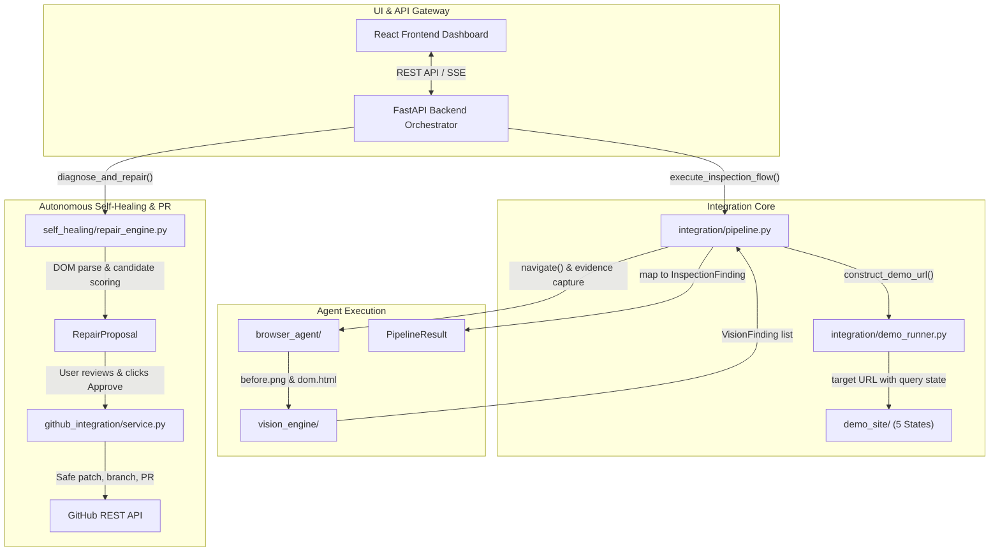
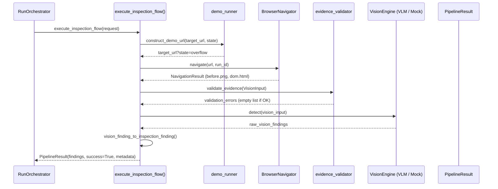
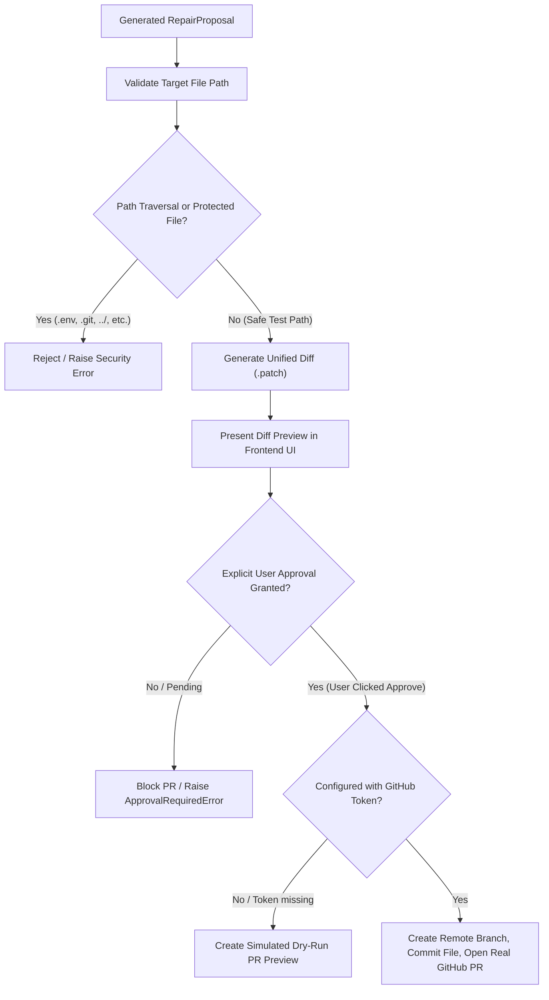

# OmniSight — Integration & Self-Healing Module Study Guide

> **Module Lead:** Prabath (Integration Lead)
> **Components:** `integration/`, `self_healing/`, `github_integration/`, `demo_site/`
> **Primary Technology:** Python 3.10+, BeautifulSoup4 / lxml, Pydantic v2, Dataclasses, Playwright, HTTPX, Git & GitHub REST APIs

---

## 1. Module Overview & Architectural Role

The **Integration Module** is the architectural backbone and orchestration glue of OmniSight. While individual team members engineered discrete components—FastAPI server, React dashboard, Playwright browser agent, and VLM visual detector—the Integration Module unifies them into an autonomous, closed-loop UI inspection and self-healing system.



### Key Responsibilities:
1. **Shared Contract Definitions (`integration/contracts.py`):** Canonical enums, dataclasses, and normalization utilities ensuring data types match across all subsystems.
2. **Deterministic Testbed & Runner (`demo_site/` & `integration/demo_runner.py`):** A zero-dependency web testbed with configurable defect switches (`clean`, `overflow`, `missing`, `image`, `all`) and HTTP reachability validation.
3. **Pipeline Adapter (`integration/pipeline.py`):** Coordinates browser navigation, evidence validation, VLM detection, and finding normalization into a single `PipelineResult`.
4. **Self-Healing Locator Repair Engine (`self_healing/`):** Analyzes damaged locators in the DOM, extracts surrounding semantic and structural attributes, synthesizes replacement candidates, ranks them using resilience scoring, and verifies uniqueness.
5. **Safe GitHub Pull Request Integration (`github_integration/`):** Generates unified diffs, enforces directory traversal and critical-file safety controls, mandates human user approval, and submits pull requests (supporting both live GitHub execution and simulated offline dry-runs).

---

## 2. Directory & Subsystem Layout

```
integration/
├── __init__.py                  # Package exports
├── contracts.py                 # Shared enums (InspectionState, DefectCategory, Severity) & dataclasses
├── demo_runner.py               # Reachability validator & URL constructor for demo states
└── pipeline.py                  # execute_inspection_flow() & PipelineResult adapter

self_healing/
├── __init__.py
├── models.py                    # CandidateLocator, RepairResult, RepairProposal, PatchResult
├── repair_engine.py             # SelfHealingRepairEngine: DOM parsing, candidate scoring, repair synthesis
├── analysis/                    # DOM element analysis & contextual attribute extraction
├── code_generation/             # Locator synthesis (data-testid, stable IDs, ARIA roles, CSS)
└── verification/                # Snapshot and live-DOM resolution & uniqueness validator

github_integration/
├── __init__.py
├── service.py                   # GitHubIntegrationService: top-level orchestrator
├── branches/                    # Branch sanitization and remote branch creation
├── commits/                     # Patch generation, directory traversal defense, core-file protection
└── pull_requests/               # ApprovalRequiredError, simulated PR preview, and GitHub REST API integration

demo_site/
├── index.html                   # Deterministic test target with switchable defect states
├── css/style.css                # Layout rules and defect triggers
└── js/script.js                 # Dynamic DOM manipulation for defect simulations
```

---

## 3. Shared Data Contracts (`integration/contracts.py`)

Defined in [`integration/contracts.py`](file:///c:/Users/praba/OneDrive/Documents/OmniSight%20-%20Multimodal%20UI%20Self-Healing%20&%20RPA%20Agent/integration/contracts.py):

### Enums
- **`InspectionState`**: `"clean"`, `"overflow"`, `"missing"`, `"image"`, `"all"`. Supports case-insensitive normalization and alias mapping.
- **`DefectCategory`**: `"overflow"`, `"missing_element"`, `"broken_image"`, `"other"`. Transparently normalizes diverse aliases (e.g., `"missing"` -> `MISSING_ELEMENT`, `"broken_img"` -> `BROKEN_IMAGE`).
- **`Severity`**: `"info"`, `"low"`, `"medium"`, `"high"`, `"critical"`.

### Data Classes
- **`InspectionRequest`**:
  ```python
  @dataclass
  class InspectionRequest:
      target_url: str
      state: InspectionState = InspectionState.CLEAN
      timeout: float = 5.0
      metadata: dict[str, Any] = field(default_factory=dict)
  ```
- **`InspectionFinding`**:
  ```python
  @dataclass
  class InspectionFinding:
      defect_category: DefectCategory
      severity: Severity
      description: str
      selector: Optional[str] = None
      confidence: Optional[float] = None
      metadata: dict[str, Any] = field(default_factory=dict)
  ```

---

## 4. End-to-End Execution Flow (`integration/pipeline.py`)

Located in [`integration/pipeline.py`](file:///c:/Users/praba/OneDrive/Documents/OmniSight%20-%20Multimodal%20UI%20Self-Healing%20&%20RPA%20Agent/integration/pipeline.py#L361-L509):



### Pipeline Steps:
1. **URL Resolution:** If inspecting the local demo site, `construct_demo_url` appends query flags (e.g. `?state=overflow` or `?defect_overflow=1`).
2. **Browser Navigation:** Executes `BrowserNavigator.navigate(url, run_id)` to record screenshots, DOM snapshot, and browser errors.
3. **Evidence Validation:** Validates that `before.png` is a non-empty PNG image and `dom.html` is readable HTML.
4. **Defect Detection:** Passes evidence to the active vision detector (real Gemini/OpenAI VLM or local DOM parser/mock).
5. **Contract Normalization:** Converts engine-specific `VisionFinding` objects into canonical `InspectionFinding` contracts stored within `PipelineResult`.

---

## 5. Self-Healing Locator Repair Engine (`self_healing/`)

When a visual or functional defect identifies a broken locator (e.g., `#broken-submit-btn`), OmniSight's self-healing engine synthesizes an alternative locator that uniquely targets the intended element.

### Repair Strategy Hierarchy
Ranked by structural stability and resilience against UI churn:

| Priority | Strategy Enum | Example Selector | Rationale |
| :---: | :--- | :--- | :--- |
| **1** | `DATA_ATTRIBUTE` | `[data-testid="submit-btn"]` | Explicit test hooks intentionally preserved across refactors. |
| **2** | `STABLE_ID` | `#checkout-submit` | High uniqueness; filters out dynamically generated volatile IDs (e.g., `:r1:`). |
| **3** | `ACCESSIBLE_ROLE_NAME` | `button[aria-label="Submit"]` | Mirrors screen-reader semantics; adheres to accessibility standards. |
| **4** | `UNIQUE_TEXT` | `button:has-text("Submit")` | High semantic clarity for user-facing actions. |
| **5** | `SEMANTIC_CSS` | `button.btn-primary.cta-btn` | Specific CSS class combination. |
| **6** | `HIERARCHICAL` | `#form-container > button` | Structural relationship fallback when attributes are ambiguous. |

### DOM Analysis & Verification Pipeline:
1. **DOM Parsing (`analysis/dom_analyzer.py`):** Parses `dom.html` using BeautifulSoup to find nearest candidate elements matching tag, text, and role signatures.
2. **Candidate Generation (`code_generation/locator_generator.py`):** Generates candidate selectors across the strategy hierarchy.
3. **Resilience Scoring & Ranking:** Evaluates each candidate's uniqueness, brevity, and stability score (0.0 to 1.0).
4. **Snapshot Validation (`verification/locator_validator.py`):** Queries the candidate against `dom.html`. It must resolve to **exactly 1 match** (`matches == 1`). If multiple elements match, the locator is disqualified or penalized.
5. **Live Verification (Optional):** If requested, opens a live headless browser session to confirm the candidate resolves uniquely in real time.

---

## 6. GitHub Integration & Security Safeguards (`github_integration/`)

Autonomous code modification requires stringent guardrails. OmniSight's GitHub integration enforces multi-layered safety controls:



### Safety & Governance Controls:

#### 1. Path Traversal & Protected File Defense:
Implemented in [`github_integration/commits/patch_generator.py`](file:///c:/Users/praba/OneDrive/Documents/OmniSight%20-%20Multimodal%20UI%20Self-Healing%20&%20RPA%20Agent/github_integration/commits/patch_generator.py):
- Prevents path traversal sequences (`../`, `..\`, absolute paths outside repository root).
- Blocks modification of sensitive files (`.env`, `.git/`, `.github/`, config files, database credentials).
- Restricts automated patch targeting to test code and UI component directories.

#### 2. Human-in-the-Loop Approval Gate:
Implemented in [`github_integration/pull_requests/pr_manager.py`](file:///c:/Users/praba/OneDrive/Documents/OmniSight%20-%20Multimodal%20UI%20Self-Healing%20&%20RPA%20Agent/github_integration/pull_requests/pr_manager.py#L131-L136):
```python
if not user_approved:
    raise ApprovalRequiredError(
        "Pull request submission requires explicit user approval. "
        "Please review the locator candidate and diff preview before confirming."
    )
```
- The backend unconditionally rejects any PR creation request if `user_approved != True`.

#### 3. Honest Simulation vs. Real PR State:
- If `GITHUB_ACCESS_TOKEN` is unset or invalid, OmniSight **does not fabricate** fake PR URLs or identifiers like `#999`.
- Instead, it explicitly marks the response with:
  ```json
  {
    "status": "simulated",
    "simulated": true,
    "pr_number": null,
    "pr_url": null,
    "message": "Dry-run simulation: PR was prepared and validated, but no remote branch or PR was created on GitHub."
  }
  ```

---

## 7. Deterministic Demo Target (`demo_site/`)

To test multimodal visual defect detection without external website dependencies, OmniSight bundles an internal testbed in `demo_site/`:

| State | URL Parameter | Defect Triggered |
| :--- | :--- | :--- |
| **`clean`** | `?state=clean` | Baseline perfect UI; no defects rendered. |
| **`overflow`** | `?state=overflow` | Injects text overflow and non-responsive layout wrapping. |
| **`missing`** | `?state=missing` | Hides primary CTA button via CSS `display: none`. |
| **`image`** | `?state=image` | Points `` tags to non-existent assets (HTTP 404 broken image). |
| **`all`** | `?state=all` | Activates all three defect triggers simultaneously. |

Reachability and status verification are managed by [`integration/demo_runner.py`](file:///c:/Users/praba/OneDrive/Documents/OmniSight%20-%20Multimodal%20UI%20Self-Healing%20&%20RPA%20Agent/integration/demo_runner.py), which checks HTTP 200 availability across all five states.

---

## 8. Test Suites & Verification

The integration module has extensive regression test coverage:

| Test File | Test Count | Scope |
| :--- | :---: | :--- |
| `tests/test_integration_contracts.py` | 18 | Validates enum parsing, aliases, dataclass serialization, and validation errors. |
| `tests/test_integration_pipeline.py` | 19 | Tests `execute_inspection_flow`, error handling, mock detection mapping, and metadata propagation. |
| `tests/test_demo_runner.py` | 10 | Validates demo URL construction and reachability across the 5 defect states. |
| `tests/test_demo_site.py` | 7 | Tests DOM structure and JavaScript defect triggers in `demo_site/index.html`. |
| `tests/test_self_healing_engine.py` | 12 | Tests candidate generation, scoring, and snapshot DOM validation. |
| `tests/test_github_integration.py` | 12 | Tests patch creation, path traversal blocking, approval gating, and simulated PRs. |
| `tests/test_e2e_integration.py` | 8 | End-to-end integration tests connecting all modules. |

### Running the Integration Suites:
```powershell
# Run the complete integration test suite
pytest tests/test_integration_contracts.py tests/test_integration_pipeline.py tests/test_self_healing_engine.py tests/test_github_integration.py -v
```

---

## 9. Real vs. Mocked Behavior & Limitations

| Feature | Current Implementation Status |
| :--- | :--- |
| **Pipeline Orchestration** | **Real**: Fully implemented in `integration/pipeline.py` connecting browser agent, evidence validation, and vision detector. |
| **5-State Demo Testbed** | **Real**: Fully implemented zero-dependency static site with CSS/JS defect switches. |
| **Self-Healing Locator Synthesis** | **Real**: Evaluates real DOM trees, checks uniqueness, and calculates confidence scores. |
| **Unified Diff Generation** | **Real**: Generates standard unified diff patches and validates target paths against traversal attacks. |
| **GitHub PR Creation** | **Hybrid**: Real HTTP REST calls to `api.github.com` when credentials exist; cleanly falls back to safe **simulated dry-run** when unauthenticated. |
| **Live Webpage Re-testing** | **Partial**: Snapshot verification is standard; live-page re-verification is optional and requires an active URL. |
| **Multi-File Refactoring** | **Limitation**: Self-healing currently repairs single locator references in specified test files; cross-repository AST refactoring is not yet supported. |

---

## 10. Viva / Oral Exam Questions & Model Answers

### Q1: What is the purpose of `integration/contracts.py`, and why can't each module maintain its own data definitions?
> **Answer:**
> In a multi-agent system where different team members build backend services, vision algorithms, and browser automation, disparate data shapes (such as calling a field `category` vs `defect_category` or `"missing"` vs `"missing_element"`) lead to subtle runtime bugs and contract breakage. `integration/contracts.py` establishes a single source of truth with strict Pydantic and dataclass models, providing bi-directional alias normalization and robust deserialization so that every subsystem communicates reliably.

### Q2: How does the Self-Healing Engine guarantee that a replacement locator is safe to use in automated test scripts?
> **Answer:**
> The engine applies a two-step validation:
> 1. **Resilience Strategy Selection:** It prefers structural attributes like `[data-testid]` or stable ARIA roles over brittle hierarchical paths.
> 2. **Uniqueness Verification:** The candidate selector is queried against the captured DOM snapshot. The engine requires `matches == 1`. If a locator matches 0 elements (broken) or more than 1 element (ambiguous), it is disqualified. Only locators uniquely identifying the target element receive a high confidence score.

### Q3: Why is human approval mandatory before creating a GitHub Pull Request?
> **Answer:**
> Autonomous agents should never have unconstrained write access to a software repository. Even high-confidence machine-generated locators might select the wrong button or violate internal styling guidelines. The human-in-the-loop approval gate (`ApprovalRequiredError`) ensures that an authorized software engineer explicitly inspects the proposed locator, the rationale, and the unified diff preview before any branch or pull request is opened on GitHub.

### Q4: How does OmniSight test defect detection deterministically without relying on flaky third-party websites?
> **Answer:**
> OmniSight includes a dedicated, self-contained testbed in `demo_site/`. By passing query parameters (`?state=clean`, `?state=overflow`, `?state=missing`, `?state=image`), dynamic CSS and JavaScript manipulate the page elements into deterministic failure modes. This allows unit and end-to-end regression tests to verify detection accuracy reliably in offline, CI/CD, and local environments without network latency or external rate limits.
