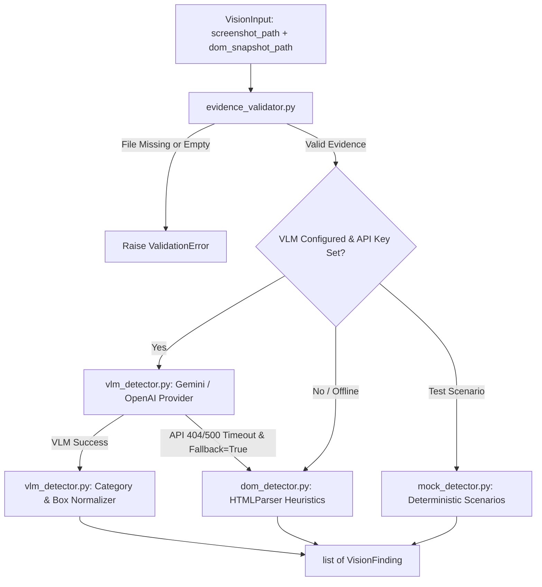

# OmniSight Vision Engine Module Study Guide
**Module Lead:** Jay | **Component:** Multimodal Visual & Structural Defect Analysis

---

## 1. Executive Summary & Architectural Role

The **Vision Engine** is the visual and structural intelligence unit of OmniSight. While traditional test automation relies purely on brittle CSS/XPath locators, the Vision Engine analyzes both the **rendered pixel appearance** (screenshot) and the **underlying document structure** (DOM snapshot) to detect UI defects that automated test suites typically miss.

### Primary Capabilities:
1. **Multimodal Defect Detection:** Leverages Vision-Language Models (VLMs) such as **Google Gemini** or **OpenAI GPT-4o** to inspect screenshots alongside DOM context.
2. **Defect Categorization:** Identifies three critical defect classes:
   - `layout_overflow`: Visual text blowout, truncated buttons, overlapping elements.
   - `missing_visible_element`: Elements defined in code or expected on screen but hidden, zero-opacity, or missing.
   - `broken_image`: 404 images, missing `src` attributes, or broken SVG/canvas renders.
3. **Evidence Validation:** Enforces strict preconditions on evidence artifacts before invoking costly model inference.
4. **Three-Tier Detection Pipeline:** Supports **Real VLM**, **Deterministic DOM Fallback**, and **Mock Mode** for offline tests.



---

## 2. Directory Structure & File Map

```text
vision_engine/
├── __init__.py                # Module exports (VisionInput, VisionFinding, detect_vlm, etc.)
├── models.py                  # Pydantic data models (VisionInput, VisionFinding, BoundingBox)
├── evidence_validator.py      # Verifies screenshot and DOM snapshot accessibility on disk
├── detection/
│   ├── __init__.py            # Exposes VLMDetector, detect_vlm, detect_mock, detect_dom_issues
│   ├── dom_detector.py        # Static HTMLParser heuristic detector (form labels, image src)
│   ├── mock_detector.py       # Deterministic scenario detector for unit tests
│   ├── providers.py           # Gemini & OpenAI HTTP client integrations and Base64 encoding
│   └── vlm_detector.py        # High-level VLM coordinator, category normalizer, fallback logic
├── prompting/
│   ├── __init__.py            # Prompt module exports
│   └── defect_prompts.py      # System prompts, JSON schemas, and response parsers
└── tests/
    ├── test_dom_detector.py   # Tests for DOM heuristic parser
    ├── test_evidence_validator.py # Tests for file accessibility, empty files, permissions
    ├── test_mock_detector.py  # Tests for deterministic mock findings
    └── test_vlm_detector.py   # Tests for VLM providers, timeouts, retries, and normalizers
```

---

## 3. Data Models (`vision_engine/models.py`)

All data moving through the Vision Engine adheres to strict **Pydantic v2** models:

### 3.1 `VisionInput`
```python
class VisionInput(BaseModel):
    run_id: str                      # Unique identifier for the inspection run
    url: str                         # Target web page URL inspected
    screenshot_path: str | None      # Relative or absolute path to before.png
    dom_snapshot_path: str | None    # Relative or absolute path to dom.html
```
- **Validator (`require_some_evidence`):** Enforces that at least one of `screenshot_path` or `dom_snapshot_path` is provided; raises `ValueError` if both are null or empty.

### 3.2 `BoundingBox`
```python
class BoundingBox(BaseModel):
    x: float          # Horizontal pixel offset from top-left
    y: float          # Vertical pixel offset from top-left
    width: float      # Bounding box width (>= 0)
    height: float     # Bounding box height (>= 0)
```

### 3.3 `VisionFinding`
```python
class VisionFinding(BaseModel):
    finding_id: str
    category: Literal["layout_overflow", "missing_visible_element", "broken_image"]
    severity: Literal["low", "medium", "high", "critical"]
    confidence: float                 # Scored between 0.0 and 1.0
    description: str                  # Human-readable defect explanation
    selector: str | None = None       # Associated CSS selector or element ID
    bounding_box: BoundingBox | None  # Pixel coordinates on screenshot
    evidence: EvidenceReferences      # Paths to screenshot and DOM snapshot
    source: Literal["mock", "vlm"]    # Distinguishes genuine AI findings from test mocks
```

---

## 4. Evidence Validation (`vision_engine/evidence_validator.py`)

Before calling external APIs, `validate_evidence(input_data: VisionInput) -> list[str]` inspects the local filesystem:
1. **File Existence:** Verifies `path.exists()` on the referenced paths.
2. **File Integrity:** Verifies `path.is_file()` (ensures paths do not resolve to directories).
3. **Non-Empty Content:** Opens the file in binary mode (`open("rb")`) and reads the first byte. If `read(1)` is empty, an error (`"file is empty"`) is appended.
4. **Usable Evidence Check:** Returns an empty error list `[]` if all provided files exist and are non-empty. If no usable files are present, returns actionable error strings.

---

## 5. Detection Engines

The Vision Engine implements three complementary detection strategies:

### 5.1 Real Vision-Language Model Detection (`vlm_detector.py` & `providers.py`)

When configured with API credentials, `detect_vlm()` sends the screenshot and DOM context to an LLM provider:
- **`GeminiVLMProvider`:**
  - Reads `GEMINI_API_KEY`. Defaults to model `gemini-1.5-flash`.
  - Base64-encodes the screenshot PNG and submits it via Google's `v1beta:generateContent` endpoint using `httpx`.
  - Sends a structured prompt requiring a strict JSON output matching `VLM_DEFECT_DETECTION_SCHEMA`.
- **`OpenAIVLMProvider`:**
  - Reads `OPENAI_API_KEY`. Defaults to model `gpt-4o`.
  - Transmits a data URI (`data:image/png;base64,...`) via the Chat Completions endpoint.
- **Normalizations:**
  - `normalize_category()` maps informal model terms (`overflow`, `clipping`, `text_overlap`) into canonical `layout_overflow`.
  - `normalize_severity()` ensures severities fall within `{"low", "medium", "high", "critical"}`.
  - `normalize_confidence()` bounds values between `0.0` and `1.0`.
- **Graceful Fallback (`allow_fallback=True`):**
  If the VLM request times out, fails network calls, or encounters an API error (e.g., 404 model not found), the detector logs a warning and automatically delegates analysis to `detect_dom_issues()`, ensuring the pipeline never crashes.

### 5.2 Deterministic DOM Heuristic Detection (`dom_detector.py`)

When running offline or as a fallback, `detect_dom_issues()` executes static structural analysis:
- Implements `_DOMIssueParser(HTMLParser)` from Python's standard library.
- **Form Controls:** Checks `<input>`, `<select>`, `<textarea>` for:
  - Explicit `<label for="...">` matching element `id`.
  - Wrapping parent `<label>`.
  - Accessibility attributes (`aria-label`, `aria-labelledby`).
  - Reports `missing_visible_element` if an unlabelled control is found.
- **Image Assets:** Inspects all `` tags:
  - Missing/empty `src` -> reports `broken_image`.
  - Missing/empty `alt` -> reports `missing_visible_element`.

### 5.3 Deterministic Mock Detection (`mock_detector.py`)

Used exclusively in fast offline unit and integration tests:
- Returns predefined, structured findings for `scenario="defect"`.
- Returns an empty list `[]` for `scenario="clean"`.
- Always tags output with `source="mock"`.

---

## 6. Execution Modes: Honest Comparison Matrix

| Feature | Real VLM Provider | DOM Heuristic Detector | Mock Detector |
| :--- | :--- | :--- | :--- |
| **Module File** | `vlm_detector.py`, `providers.py` | `dom_detector.py` | `mock_detector.py` |
| **Visual Analysis** | Analyzes rendered pixels via Base64 | None (parses HTML structure only) | None (pre-programmed) |
| **External Dependency** | Gemini or OpenAI API Key | None (Standard Library Python) | None |
| **Execution Cost** | API token cost per run | Free ($0) | Free ($0) |
| **Typical Latency** | 1,500ms – 4,000ms | 5ms – 25ms | < 1ms |
| **Source Attribute** | `source="vlm"` | `source="mock"` | `source="mock"` |
| **Bounding Box** | Extracted from model output | Null | Null or synthetic |

---

## 7. Testing Guide

Run all Vision Engine test suites:

```powershell
# Run the entire vision engine test suite
pytest vision_engine/tests

# Run VLM detector provider tests (includes mocked API tests)
pytest vision_engine/tests/test_vlm_detector.py -v

# Run evidence validator tests
pytest vision_engine/tests/test_evidence_validator.py -v
```
*Note: Unit tests mock network calls with synthetic HTTP responses; they do not consume live API credits.*

---

## 8. Common Pitfalls & Troubleshooting

- **Symptom: `VLMConfigurationError: No API key configured for provider 'gemini'`**
  - *Cause:* Neither `GEMINI_API_KEY` nor `OPENAI_API_KEY` is present in the environment or `.env`.
  - *Remedy:* Set the variable in `.env` or permit fallback by running with `allow_fallback=True`.
- **Symptom: `Evidence validation failed: screenshot file does not exist`**
  - *Cause:* Browser navigation failed before the screenshot was captured, or path was wrong.
  - *Remedy:* Verify `BrowserNavigator.navigate()` returned `status="success"` before passing input to Vision Engine.
- **Symptom: JSON decode errors from VLM response.**
  - *Cause:* Some models output Markdown markdown fences (````json ... ````).
  - *Handled:* `parse_vlm_json_response()` in `defect_prompts.py` strips fences automatically using regex.

---

## 9. Likely Viva / Oral Examination Questions & Answers

**Q1: Why does OmniSight require both visual screenshots and DOM snapshots for defect analysis?**  
*Answer:* A screenshot captures the rendered visual truth (overlapping text, clipping, visual 404 image icons) which is impossible to detect purely from HTML strings. Conversely, the DOM snapshot provides exact element tags, IDs, classes, and accessibility attributes needed for self-healing locator repair. Combining both gives multimodal coverage.

**Q2: How does the Vision Engine handle VLM API rate limits or network dropouts?**  
*Answer:* The engine implements a graceful fallback mechanism. In `vlm_detector.py`, when `allow_fallback=True` is enabled, any network error, timeout, or invalid HTTP status caught from the external provider logs a warning and automatically executes `detect_dom_issues()`. This guarantees the inspection run finishes with actionable findings instead of crashing the pipeline.

**Q3: How does OmniSight ensure that mock results are never mistaken for real AI detections?**  
*Answer:* The `VisionFinding` and `FindingResponse` schemas require a strict `source` attribute constrained to `Literal["vlm", "mock"]`. Mock detectors and DOM fallback detectors explicitly tag findings as `"mock"`, whereas genuine model responses are tagged as `"vlm"`.

**Q4: How does the prompt engineering prevent the Vision-Language Model from hallucinating invalid JSON?**  
*Answer:* `defect_prompts.py` injects a rigorous system prompt along with a formal JSON schema (`VLM_DEFECT_DETECTION_SCHEMA`). Additionally, `parse_vlm_json_response()` extracts JSON blocks from response strings, strips Markdown formatting, and validates each item through Pydantic models before returning findings.
